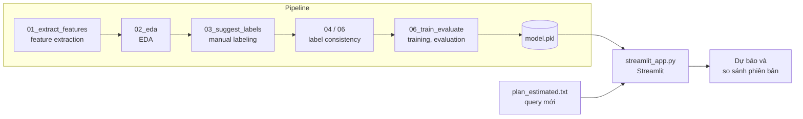

# Dự Báo Mức Tiêu Thụ Tài Nguyên Của SQL Query Từ Estimated Execution Plan

**Python · pandas · scikit-learn · matplotlib · Streamlit · Oracle Database**

Nhiệm vụ bổ sung trong báo cáo thực tập Học kỳ doanh nghiệp ngành Hệ thống thông tin kinh doanh. Dự án xây dựng mô hình ML dự báo mức tiêu thụ tài nguyên của một SQL query **trước khi chạy**, chỉ dựa trên estimated execution plan do Oracle optimizer tạo ra.


---

## Danh Mục Viết Tắt

| Viết tắt | Từ đầy đủ | Nghĩa |
|---|---|---|
| CPU | Central Processing Unit | Bộ xử lý trung tâm |
| CV | Cross-Validation | Kiểm định chéo |
| DT | Decision Tree | Cây quyết định |
| EDA | Exploratory Data Analysis | Phân tích khám phá dữ liệu |
| GB | Gradient Boosting | Mô hình tăng cường gradient |
| I/O | Input/Output | Nhập/xuất dữ liệu |
| ML | Machine Learning | Học máy |
| OEM | Oracle Enterprise Manager | Công cụ quản trị và giám sát hệ thống của Oracle |
| QWK | Quadratic Weighted Kappa | Hệ số Kappa có trọng số bậc hai |
| RF | Random Forest | Rừng ngẫu nhiên |
| SQL | Structured Query Language | Ngôn ngữ truy vấn có cấu trúc |
| UEH | University of Economics Ho Chi Minh City | Đại học Kinh tế TP. Hồ Chí Minh |

---

## Tổng Quan Dự Án

Các SQL query phục vụ báo cáo định kỳ thường được tối ưu qua nhiều phiên bản, hiện nay, mức độ nặng của một query chỉ được biết **sau khi chạy xong**, thông qua elapsed time; mỗi lần thử một phiên bản mới tốn từ vài phút đến vài chục phút cùng tài nguyên của database server.

Dự án tiếp cận theo hướng ngược lại: dùng estimated execution plan (tạo bằng lệnh `EXPLAIN PLAN` trong vài giây, không thực thi query) để dự báo query sẽ thuộc label **Normal**, **Warning** hay **Critical**.

Pipeline gồm các bước:

- Parse execution plan dạng text và trích xuất feature
- EDA để chọn ngưỡng label và loại các feature trùng lặp
- Manual labeling ba mức dựa trên số liệu sau khi chạy
- Kiểm tra độ nhất quán của labeling trước khi huấn luyện
- Huấn luyện các mô hình tree-based, so sánh với hai baseline
- Đánh giá bằng Repeated Stratified K-Fold CV
- Đóng gói thành Streamlit app

### Mục Tiêu

- Xây dựng bộ feature chỉ gồm thông tin có trước khi chạy, tránh data leakage (rò rỉ thông tin của label vào feature)
- Đánh giá khả năng dự báo mức tiêu thụ tài nguyên từ estimated plan
- Kiểm chứng mô hình ML có tốt hơn quy tắc dựa trên estimated time của Oracle hay không
- Cung cấp công cụ hỗ trợ chọn phiên bản query nên chạy thật trong quá trình tuning

---

## Dữ Liệu

Do yêu cầu bảo mật của ngân hàng, dữ liệu vận hành thật không được đưa ra khỏi hệ thống. Dataset trong repo đã được hiệu chỉnh theo một bản ghi mẫu đã ẩn danh toàn bộ tên table, bind variable

### Đặc Điểm Dataset

| Thuộc tính | Giá trị |
|---|---|
| Số lần chạy (bản ghi) | 90 |
| Số query gốc | khoảng 20 (mỗi query có 1 đến 8 phiên bản tuning) |
| Số feature | 30 (trước khi loại feature không đổi và trùng lặp) |
| Label | 3 mức có thứ bậc: Normal < Warning < Critical |

### Các File Trong Mỗi Lần Chạy

| File | Thời điểm có thông tin | Vai trò |
|---|---|---|
| `plan_estimated.txt` | Trước khi chạy | Input của mô hình |
| `summary.json` | Sau khi chạy | Căn cứ labeling; kiểm tra estimated plan có khớp actual plan |
| `plan_allstats.txt`, `plan_stats.csv` | Sau khi chạy | Đối chiếu khi labeling; so sánh cấu trúc plan |
| `sql_monitor.txt`, `report.txt` | Sau khi chạy | Tham khảo |
| `query.sql` | Trước khi chạy | Không sử dụng |

---

## Bối Cảnh Nghiệp Vụ

Trong quá trình tuning, một query báo cáo có thể được viết lại nhiều lần (V1, V2, ...). Nếu biết trước phiên bản nào có nguy cơ tiêu tốn nhiều tài nguyên, người tuning chỉ cần chạy thật các phiên bản có triển vọng, tiết kiệm thời gian chờ và tài nguyên của database server dùng chung.

Câu hỏi nghiên cứu:

- Các feature của estimated plan (cost, cấu trúc operation, partition, temp space) phân biệt được ba mức tiêu thụ tài nguyên đến đâu?
- Mô hình ML có vượt được baseline dựa trên ngưỡng estimated time của Oracle không?
- Những feature nào ảnh hưởng nhiều nhất đến kết quả dự báo?

---

## Kiến Trúc Dự Án



Hàm parse plan và hàm tính feature trong `src/common.py` được dùng chung cho bước training và app, bảo đảm feature lúc dự báo được tính giống hệt lúc huấn luyện. Mọi đường dẫn được khai báo tập trung trong `src/config.py`.

---

## Pipeline

```
00_check_env → 01_extract_features → 02_eda → 03_suggest_labels → 04_relabel_sample → 05_label_agreement → 06_train_evaluate → app
```

| Bước | File | Mục đích |
|---|---|---|
| 1 | `00_check_env.py` | Kiểm tra phiên bản Python và thư viện |
| 2 | `01_extract_features.py` | Trích xuất feature, số liệu để labeling, đối chiếu estimated plan với actual plan |
| 3 | `02_eda.py` | Phân phối elapsed time, Spearman correlation, các cặp feature trùng lặp |
| 4 | `03_suggest_labels.py` | Tạo bảng labeling kèm gợi ý theo ngưỡng |
| 5 | `04_relabel_sample.py` | Tạo bảng relabel "mù" cho 20% số mẫu |
| 6 | `05_label_agreement.py` | Đo độ nhất quán giữa hai lần labeling bằng weighted Kappa |
| 7 | `06_train_evaluate.py` | Training, CV, permutation importance, lưu model |
| App | `streamlit_app.py` | Dự báo và so sánh các phiên bản query |
| Dùng chung | `common.py`, `config.py` | Parse plan, tính feature, đọc `summary.json`, so sánh cấu trúc plan; khai báo đường dẫn |

---

## Phương Pháp

### Giai Đoạn 1: Data Understanding
- Parse bảng execution plan theo tên cột thay vì vị trí cột, dùng chung cho estimated plan và actual plan
- Đối chiếu cấu trúc hai plan (bỏ qua các operation PX của parallel execution) để đánh giá mức tin cậy của estimated plan

### Giai Đoạn 2: Feature Engineering
- Chỉ dùng thông tin có trước khi chạy; elapsed time, CPU time và buffer gets sau khi chạy chỉ dùng để labeling
- Loại feature không đổi và các cặp có Spearman correlation từ 0,90 trở lên

### Giai Đoạn 3: Labeling
- Ngưỡng theo ý nghĩa vận hành, tham khảo phân phối elapsed time; tên label theo hai mức cảnh báo Warning/Critical của OEM
- Manual labeling từng bản ghi, đối chiếu thêm tỉ lệ CPU, wait time, mức dùng temp space
- Sau vài ngày, relabel 20% số mẫu và đo độ nhất quán; chỉ chuyển sang training khi độ nhất quán đạt yêu cầu

### Giai Đoạn 4: Modeling

| Loại | Phương pháp | Vai trò |
|---|---|---|
| Baseline 1 | Majority class (luôn đoán lớp phổ biến nhất) | Mức kết quả tối thiểu |
| Baseline 2 | Hai ngưỡng trên estimated time (`Time`), học trên training set | Phép thử giá trị của ML |
| ML | DT, RF, GB | Mô hình dự báo |

### Giai Đoạn 5: Evaluation
- Repeated Stratified K-Fold CV, 5 fold × 10 lần lặp; các phiên bản của cùng một query gốc nằm trong cùng một fold
- Chỉ số chính: macro-F1 (trung bình ± độ lệch chuẩn); chỉ số phụ: QWK, accuracy
- Permutation importance trên test set để đo mức ảnh hưởng của từng feature

---

## Danh Mục Feature

| Nhóm | Feature |
|---|---|
| Cost ước lượng | `est_cost`, `est_cpu_pct`, `est_time_s` |
| Cardinality và dung lượng ước lượng | `est_rows_root`, `est_bytes_root`, `est_rows_max`, `est_bytes_max`, `est_bytes_table_access` |
| Temp space ước lượng | `est_temp_total`, `has_temp` |
| Độ phức tạp của plan | `n_steps`, `max_depth`, `n_objects` |
| Loại operation | `n_full_scan`, `n_table_full_scan`, `n_index_access`, `n_hash_join`, `n_nested_loops`, `n_merge_join`, `n_sort`, `n_group_by`, `n_view`, `n_filter` |
| Partition | `n_partition_ops`, `n_partition_all` |
| Parallel execution | `n_px` |
| Thông tin bổ sung | `n_hints`, `note_dynamic_sampling`, `note_adaptive`, `bind_range_days` |

---

## Streamlit App

| Chức năng | Mô tả |
|---|---|
| Dự báo | Nạp một file `plan_estimated.txt`, nhận label dự báo kèm độ tin cậy |
| So sánh phiên bản | Nạp nhiều file cùng lúc, nhận bảng so sánh và gợi ý phiên bản nên chạy thật |

> TODO: thêm ảnh chụp màn hình app.

---

## Hạn Chế

- **Tính đại diện của dataset:** dữ liệu phần lớn là phiên bản đã qua tuning; không phản ánh biến động tải vào giờ cao điểm.

---

## Công Nghệ

| Hạng mục | Công cụ |
|---|---|
| Ngôn ngữ | Python 3.9+ |
| Xử lý dữ liệu | pandas, NumPy |
| ML | scikit-learn |
| Trực quan hóa | matplotlib |
| App | Streamlit |
| Notebook | Jupyter (ipykernel) |
| Lưu model | joblib |

---

## Cấu Trúc Thư Mục

```
sql-plan-resource-prediction/
├── data/
│   ├── raw/                  # Các folder lần chạy
│   ├── interim/              # features.csv, label_sheet.csv, check_report.csv
│   └── labeled/              # labels.csv, relabel_sheet.csv
├── environment/
│   └── requirements.txt
├── src/
│   ├── config.py
│   ├── common.py
│   ├── 00_check_env.py
│   ├── 01_extract_features.py
│   ├── 02_eda.py
│   ├── 03_suggest_labels.py
│   ├── 04_relabel_sample.py
│   ├── 05_label_agreement.py
│   └── 06_train_evaluate.py
├── app/
│   └── streamlit_app.py
├── models/                   # model.pkl, run_info.json
├── reports/
│   ├── figures/              # eda/, results/
│   └── tables/               # eda/, results/
├── docs/
│   └── HUONG_DAN.md
├── main.ipynb
├── .gitignore
└── README.md
```

---

## Cài Đặt Và Sử Dụng

### Yêu Cầu
- Python 3.9 trở lên
- Các thư viện trong `environment/requirements.txt`

### Cài Đặt
```bash
python -m pip install -r environment/requirements.txt
python src/00_check_env.py
```

## Trạng Thái

| Hạng mục | Trạng thái |
|---|---|
| Chuẩn bị môi trường | Chưa thực hiện |
| Feature extraction | Chưa thực hiện |
| EDA | Chưa thực hiện |
| Manual labeling | Chưa thực hiện |
| Độ nhất quán labeling | Chưa thực hiện |
| Training và evaluation | Chưa thực hiện |
| Streamlit app | Chưa thực hiện |

---

## Tác Giả

- Dương Thanh Ngọc, sinh viên K49, Hệ thống thông tin kinh doanh, UEH

---

## Tài Liệu Tham Khảo

- Kasa, S. R., et al. (2024). *Exploring Ordinality in Text Classification: A Comparative Study of Explicit and Implicit Techniques.* Findings of ACL 2024.
- Li, M., Gao, Q., & Yu, T. (2023). *Kappa statistic considerations in evaluating inter-rater reliability between two raters.* BMC Cancer, 23, 799.
- Vanbelle, S., & Hernandez Engelhart, C. (2024). *A comprehensive guide to study the agreement and reliability of multi-observer ordinal data.* BMC Medical Research Methodology.
- Oracle. *Enterprise Manager Cloud Control: Metric Thresholds.*
- Oracle. *Database SQL Tuning Guide: DBMS_XPLAN và SQL Monitor.*
- scikit-learn documentation: model selection, ensemble methods, permutation importance.

---

*Báo cáo thực tập Học kỳ doanh nghiệp, Đại học Kinh tế TP. Hồ Chí Minh (UEH).*