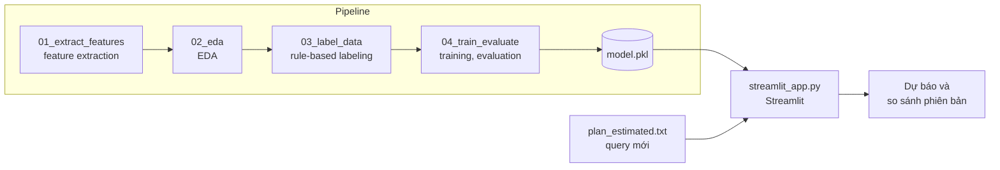
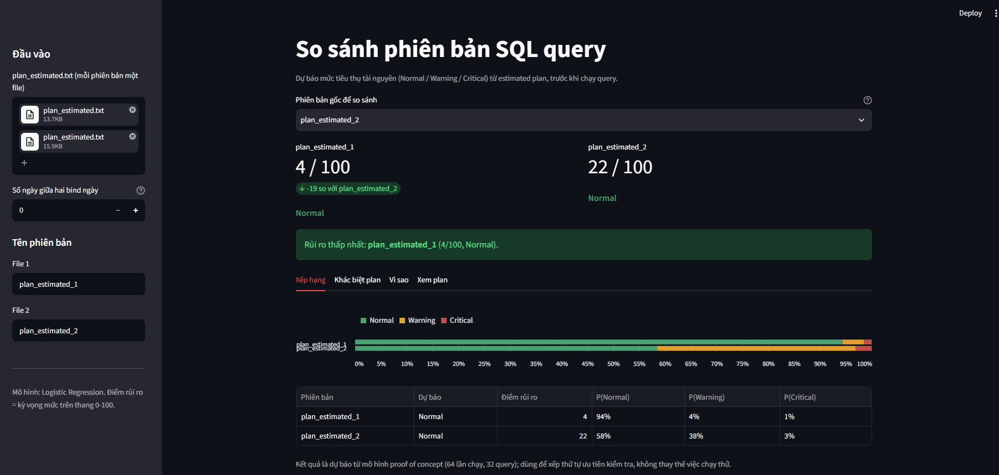

# Dự Báo Mức Tiêu Thụ Tài Nguyên Của SQL Query Từ Estimated Execution Plan

**Python · pandas · scikit-learn · matplotlib · Streamlit · Oracle Database**

Nhiệm vụ bổ sung trong báo cáo thực tập Học kỳ doanh nghiệp ngành Hệ thống thông tin kinh doanh. Dự án xây dựng mô hình ML dự báo mức tiêu thụ tài nguyên của một SQL query **trước khi chạy**, chỉ dựa trên estimated execution plan do Oracle optimizer tạo ra.


---

## Danh Mục Viết Tắt

| Viết tắt | Từ đầy đủ | Nghĩa |
|---|---|---|
| CPU | Central Processing Unit | Bộ xử lý trung tâm |
| CV | Cross-Validation | Kiểm định chéo |
| DT | Decision Tree | Cây quyết định |
| EDA | Exploratory Data Analysis | Phân tích khám phá dữ liệu |
| GB | Gradient Boosting | Mô hình tăng cường gradient |
| I/O | Input/Output | Nhập/xuất dữ liệu |
| ML | Machine Learning | Học máy |
| OEM | Oracle Enterprise Manager | Công cụ quản trị và giám sát hệ thống của Oracle |
| QWK | Quadratic Weighted Kappa | Hệ số Kappa có trọng số bậc hai |
| RF | Random Forest | Rừng ngẫu nhiên |
| SQL | Structured Query Language | Ngôn ngữ truy vấn có cấu trúc |
| UEH | University of Economics Ho Chi Minh City | Đại học Kinh tế TP. Hồ Chí Minh |

---

## Tổng Quan Dự Án

Các SQL query phục vụ báo cáo định kỳ thường được tối ưu qua nhiều phiên bản, hiện nay, mức độ nặng của một query chỉ được biết **sau khi chạy xong**, thông qua elapsed time; mỗi lần thử một phiên bản mới tốn từ vài phút đến vài chục phút cùng tài nguyên của database server.

Dự án tiếp cận theo hướng ngược lại: dùng estimated execution plan (tạo bằng lệnh `EXPLAIN PLAN` trong vài giây, không thực thi query) để dự báo query sẽ thuộc label **Normal**, **Warning** hay **Critical**.

Pipeline gồm các bước:

- Parse execution plan dạng text và trích xuất feature
- Tiền xử lý và EDA: kiểm tra giá trị thiếu, phát hiện outlier, phân tích phân phối và tương quan, loại feature hằng, hiếm và trùng lặp
- Gán label ba mức tự động theo quy tắc trên số liệu sau khi chạy, kèm kiểm tra độ nhạy của ngưỡng
- Huấn luyện các mô hình tree-based, so sánh với hai baseline
- Đánh giá bằng Repeated Stratified K-Fold CV
- Đóng gói thành Streamlit app

### Mục Tiêu

- Xây dựng bộ feature chỉ gồm thông tin có trước khi chạy, tránh data leakage (rò rỉ thông tin của label vào feature)
- Đánh giá khả năng dự báo mức tiêu thụ tài nguyên từ estimated plan
- Kiểm chứng mô hình ML có tốt hơn quy tắc dựa trên estimated time của Oracle hay không
- Cung cấp công cụ hỗ trợ chọn phiên bản query nên chạy thật trong quá trình tuning

---

## Dữ Liệu

Do yêu cầu bảo mật của ngân hàng, dữ liệu vận hành thật không được đưa ra khỏi hệ thống. Dataset trong repo đã được hiệu chỉnh theo một bản ghi mẫu đã ẩn danh toàn bộ tên table, bind variable

### Đặc Điểm Dataset

| Thuộc tính | Giá trị |
|---|---|
| Số lần chạy (bản ghi) | 64 |
| Số query gốc | 32 (mỗi query có 1 đến 4 lần chạy, thuộc các phiên bản V1 đến V9) |
| Số feature | 30 (trước khi loại feature không đổi, feature hiếm và feature trùng lặp) |
| Label | 3 mức có thứ bậc: Normal < Warning < Critical |

### Các File Trong Mỗi Lần Chạy

| File | Thời điểm có thông tin | Vai trò |
|---|---|---|
| `plan_estimated.txt` | Trước khi chạy | Input của mô hình |
| `summary.json` | Sau khi chạy | Căn cứ labeling; kiểm tra estimated plan có khớp actual plan |
| `plan_allstats.txt`, `plan_stats.csv` | Sau khi chạy | Đối chiếu khi labeling; so sánh cấu trúc plan |
| `sql_monitor.txt`, `report.txt` | Sau khi chạy | Tham khảo |
| `query.sql` | Trước khi chạy | Không sử dụng |

---

## Bối Cảnh Nghiệp Vụ

Trong quá trình tuning, một query báo cáo có thể được viết lại nhiều lần (V1, V2, ...). Nếu biết trước phiên bản nào có nguy cơ tiêu tốn nhiều tài nguyên, người tuning chỉ cần chạy thật các phiên bản có triển vọng, tiết kiệm thời gian chờ và tài nguyên của database server dùng chung.

Câu hỏi nghiên cứu:

- Các feature của estimated plan (cost, cấu trúc operation, partition, temp space) phân biệt được ba mức tiêu thụ tài nguyên đến đâu?
- Mô hình ML có vượt được baseline dựa trên ngưỡng estimated time của Oracle không?
- Những feature nào ảnh hưởng nhiều nhất đến kết quả dự báo?

---

## Kiến Trúc Dự Án



Hàm parse plan và hàm tính feature trong `src/common.py` được dùng chung cho bước training và app, bảo đảm feature lúc dự báo được tính giống hệt lúc huấn luyện. Mọi đường dẫn được khai báo tập trung trong `src/config.py`.

---

## Pipeline

```
00_check_env → 01_extract_features → 02_eda → 03_label_data → 04_train_evaluate → app
```

| Bước | File | Mục đích |
|---|---|---|
| 1 | `00_check_env.py` | Kiểm tra phiên bản Python và thư viện |
| 2 | `01_extract_features.py` | Trích xuất feature, số liệu để labeling, đối chiếu estimated plan với actual plan |
| 3 | `02_eda.py` | Kiểm tra giá trị thiếu, loại feature hằng và feature hiếm, phát hiện outlier (chỉ báo cáo), phân phối elapsed time, Spearman correlation, loại các cặp feature trùng lặp; ghi `features_clean.csv` (kèm cột `ref_est_time_s` cho baseline) |
| 4 | `03_label_data.py` | Gán label tự động theo quy tắc, ghi kèm quy tắc đã kích hoạt; dời ngưỡng ±10% và đo tỉ lệ label bị đổi |
| 5 | `04_train_evaluate.py` | Training, CV, permutation importance, lưu model |
| App | `streamlit_app.py` | Dự báo và so sánh các phiên bản query |
| Dùng chung | `common.py`, `config.py` | Parse plan, tính feature, đọc `summary.json`, so sánh cấu trúc plan; khai báo đường dẫn |

---

## Phương Pháp

### Giai Đoạn 1: Data Understanding
- Parse bảng execution plan theo tên cột thay vì vị trí cột, dùng chung cho estimated plan và actual plan
- Đối chiếu cấu trúc hai plan (bỏ qua các operation PX của parallel execution) để đánh giá mức tin cậy của estimated plan

### Giai Đoạn 2: Feature Engineering
- Chỉ dùng thông tin có trước khi chạy; elapsed time, CPU time và buffer gets sau khi chạy chỉ dùng để labeling
- Giá trị thiếu: điền bằng trung vị của feature
- Outlier: phát hiện bằng IQR (1,5 × IQR) trên feature liên tục và chỉ báo cáo, giữ nguyên giá trị vì các query lớn là quan sát thật và thuộc lớp cần dự báo; cờ 0/1 và feature có tối đa 4 giá trị khác nhau không xét outlier
- Loại feature không đổi và feature hiếm (ít hơn 5 lần chạy có giá trị khác giá trị phổ biến nhất của feature)
- Loại các cặp feature có Spearman correlation từ 0,90 trở lên, giữ feature đứng trước trong danh sách; mọi feature bị loại và lý do ghi trong `feature_filter.csv`
- Hồi quy logistic dùng thêm biến đổi `log1p` và chuẩn hóa; mô hình dựa trên cây dùng giá trị gốc

### Giai Đoạn 3: Labeling
- Ngưỡng theo ý nghĩa vận hành, tham khảo phân phối elapsed time; tên label theo hai mức cảnh báo Warning/Critical của OEM
- Gán label tự động bằng quy tắc xác định sẵn (chỉ số chính, ngưỡng, quy tắc nâng bậc, thứ tự ưu tiên); mỗi bản ghi lưu kèm quy tắc đã kích hoạt
- Cơ sở của từng ngưỡng và quy tắc: `docs/LABEL_RULES.md`
- Độ nhạy của ngưỡng: dời từng ngưỡng ±10% và đo tỉ lệ bản ghi đổi label

### Giai Đoạn 4: Modeling

| Loại | Phương pháp | Vai trò |
|---|---|---|
| Baseline 1 | Majority class (luôn đoán lớp phổ biến nhất) | Mức kết quả tối thiểu |
| Baseline 2 | Hai ngưỡng trên estimated time (`Time`), học trên training set | Phép thử giá trị của ML |
| ML | DT, RF, GB, hồi quy logistic | Mô hình dự báo; siêu tham số cố định từ trước, không tinh chỉnh theo kết quả |

### Giai Đoạn 5: Evaluation
- Stratified Group K-Fold, 5 fold × 10 lần lặp; các phiên bản của cùng một query gốc nằm trong cùng một fold; không có tập test riêng
- Chỉ số chính: macro-F1 (trung bình ± độ lệch chuẩn giữa các fold); chỉ số phụ: QWK, accuracy; F1 train chỉ dùng để chẩn đoán overfit
- Mọi bước có học từ dữ liệu, kể cả ngưỡng của baseline, chỉ học trên phần train của từng fold; mô hình cuối cho app được huấn luyện lại trên toàn bộ dữ liệu
- Kiểm tra bổ sung: nhãn bị xáo trộn (kiểm tra rò rỉ), bỏ các lần chạy ngày cao điểm, chia fold không phân tầng, learning curve
- Permutation importance trên test set để đo mức ảnh hưởng của từng feature

---

## Danh Mục Feature

| Nhóm | Feature |
|---|---|
| Cost ước lượng | `est_cost`, `est_cpu_pct`, `est_time_s` |
| Cardinality và dung lượng ước lượng | `est_rows_root`, `est_bytes_root`, `est_rows_max`, `est_bytes_max`, `est_bytes_table_access` |
| Temp space ước lượng | `est_temp_total`, `has_temp` |
| Độ phức tạp của plan | `n_steps`, `max_depth`, `n_objects` |
| Loại operation | `n_full_scan`, `n_table_full_scan`, `n_index_access`, `n_hash_join`, `n_nested_loops`, `n_merge_join`, `n_sort`, `n_group_by`, `n_view`, `n_filter` |
| Partition | `n_partition_ops`, `n_partition_all` |
| Parallel execution | `n_px` |
| Thông tin bổ sung | `n_hints`, `note_dynamic_sampling`, `note_adaptive`, `bind_range_days` |

---

## Streamlit App

| Chức năng | Mô tả |
|---|---|
| Dự báo | Nạp các file `plan_estimated.txt`, nhận label dự báo, xác suất từng mức và điểm rủi ro 0 đến 100 |
| So sánh phiên bản | Chọn phiên bản gốc, xem chênh lệch điểm rủi ro và xếp hạng các phiên bản |
| Khác biệt plan | Chênh lệch estimated time, cost, số bước, full scan, join, sort, partition, temp space so với phiên bản gốc |
| Giải thích | Các feature làm điểm rủi ro của một phiên bản cao hơn hoặc thấp hơn phiên bản gốc |



Chạy app: `streamlit run app/streamlit_app.py`

---

## Hạn Chế

- **Quy mô dataset:** 64 bản ghi từ 32 query gốc; cross-validation chia theo nhóm query nên số đơn vị độc lập là 32 và độ lệch chuẩn của kết quả lớn. Chia theo nhóm tránh để các phiên bản của cùng một query nằm ở cả train và test, nên điểm thấp hơn nhưng không bị thổi phồng. Learning curve cho thấy macro-F1 của hồi quy logistic tăng từ 0,32 lên 0,59 khi số query huấn luyện tăng từ 30% lên 100%, nên thêm query độc lập là hướng cải thiện chính.
- **Định nghĩa label:** quy tắc nâng bậc khi tràn đĩa đóng góp 8 trong 17 bản ghi Critical; label phụ thuộc vào định nghĩa này. Tràn đĩa là dấu hiệu thiếu bộ nhớ, tốn tài nguyên ngoài thời gian chạy, nên được giữ trong định nghĩa; model dự báo kết quả của chính quy tắc này.
- **Ngày cao điểm:** 7 bản ghi chạy vào ngày cao điểm có elapsed cao hơn khoảng 1,6 đến 2,6 lần; kết quả được báo cáo cả khi có và khi bỏ các bản ghi này. Giữ các bản ghi này vì tải cao điểm là điều kiện vận hành thật, và báo cáo cả hai trường hợp để thấy mức phụ thuộc.
- **Độ nhạy ngưỡng:** dời ngưỡng ±10% làm đổi label của 1,6% đến 4,7% bản ghi. Hai ngưỡng nằm trong các khoảng trống của phân phối elapsed nên ít bản ghi nằm sát ngưỡng.
- **Tín hiệu của estimated plan:** Spearman giữa estimated time và elapsed thực tế là 0,42. Estimated plan chỉ phản ánh cấu trúc truy vấn, không biết tải hệ thống và dữ liệu thực tế lúc chạy, nên đây là giới hạn của đầu vào chứ không phải của thuật toán.
- **Hiệu quả dự báo:** macro-F1 trên tập test cao nhất là 0,59 (hồi quy logistic) so với 0,41 của baseline dựa trên estimated time; có overfit rõ (F1 train 0,71 đến 1,00); điểm phụ thuộc cách chia fold (0,59 khi phân tầng, 0,48 khi không phân tầng). Model được dùng để xếp thứ tự ưu tiên kiểm tra các phiên bản, không thay thế việc chạy thử; với nhãn xáo trộn điểm rơi về mức ngẫu nhiên (0,27 đến 0,30) nên kết quả không đến từ rò rỉ dữ liệu.

---

## Công Nghệ

| Hạng mục | Công cụ |
|---|---|
| Ngôn ngữ | Python 3.9+ |
| Xử lý dữ liệu | pandas, NumPy |
| ML | scikit-learn |
| Trực quan hóa | matplotlib |
| App | Streamlit |
| Notebook | Jupyter (ipykernel) |
| Lưu model | joblib |

---

## Cấu Trúc Thư Mục

```
sql-plan-resource-prediction/
├── data/
│   ├── raw/                  # Các folder lần chạy
│   ├── interim/              # features.csv, features_clean.csv, check_report.csv
│   └── labeled/              # labels.csv, label_sensitivity.csv
├── environment/
│   └── requirements.txt
├── src/
│   ├── config.py
│   ├── common.py
│   ├── 00_check_env.py
│   ├── 01_extract_features.py
│   ├── 02_eda.py
│   ├── 03_label_data.py
│   └── 04_train_evaluate.py
├── app/
│   └── streamlit_app.py
├── models/                   # model.pkl, run_info.json
├── reports/
│   ├── figures/              # eda/, results/
│   └── tables/               # eda/, results/
├── docs/
│   ├── images/               # Ảnh chụp app
│   └── LABEL_RULES.md
├── main.ipynb
├── .gitignore
└── README.md
```

---

## Cài Đặt Và Sử Dụng

### Yêu Cầu
- Python 3.9 trở lên
- Các thư viện trong `environment/requirements.txt`

### Cài Đặt
```bash
python -m pip install -r environment/requirements.txt
python src/00_check_env.py
```

---

## Tác Giả

- Dương Thanh Ngọc, sinh viên K49, Hệ thống thông tin kinh doanh, UEH

---

## Tài Liệu Tham Khảo

- Kasa, S. R., et al. (2024). *Exploring Ordinality in Text Classification: A Comparative Study of Explicit and Implicit Techniques.* Findings of ACL 2024.
- Oracle. *Enterprise Manager Cloud Control: Metric Thresholds.*
- Oracle. *Database SQL Tuning Guide: DBMS_XPLAN và SQL Monitor.*
- scikit-learn documentation: model selection, ensemble methods, permutation importance.

---

*Báo cáo thực tập Học kỳ doanh nghiệp, Đại học Kinh tế TP. Hồ Chí Minh (UEH).*